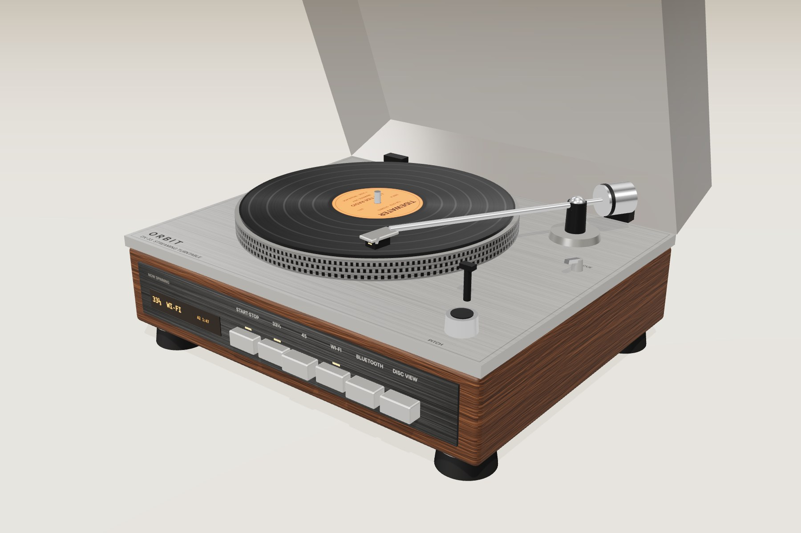

# ORBIT DX‑33 — digital vinyl player concept

A turntable whose record is a round screen. It streams over Wi‑Fi (Spotify Connect, TIDAL Connect, AirPlay 2, Google Cast) or plays from your phone over Bluetooth, and spins at a real 33⅓ or 45 rpm. By default the disc shows the record as it was originally sold: the label, vinyl color and track gaps of that pressing, rebuilt from an online release database. The **Disc View** key switches it to the cover art.

- **Interactive prototype:** `index.html`, served with GitHub Pages
- **Hardware renders:** `renders.html`

## Try it
Open `index.html` in a browser, or use the GitHub Pages link for this repo. Things to try: the piano keys, Original pressing / Cover art, switching between Wi‑Fi and Bluetooth, and clicking a track to move the tonearm.

Album names, record labels and artwork are fictional. No network calls are made.
